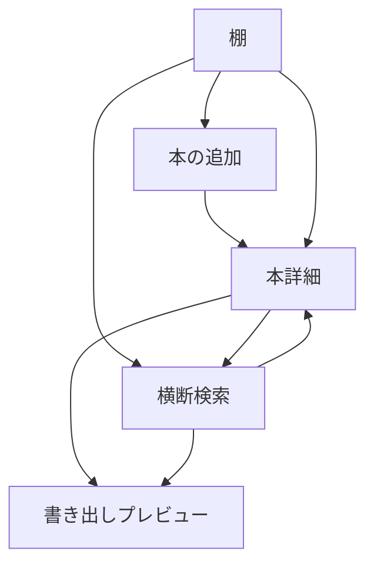
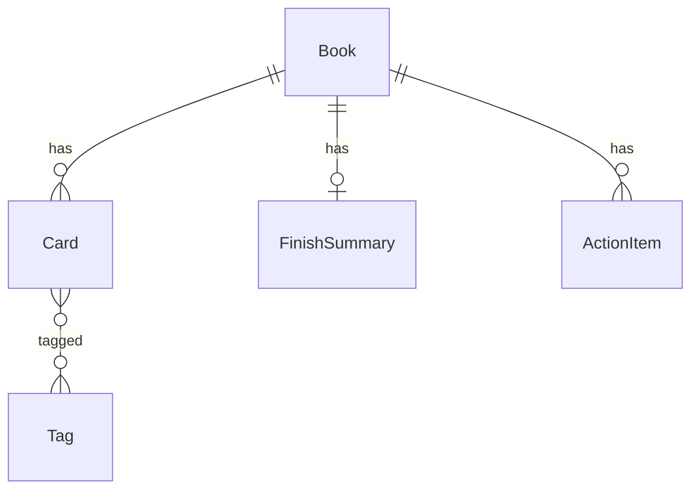

# 読書アプリ 要件定義書

- 版: 0.1
- 作成日: 2026-08-18
- ステータス: 壁打ち反映済み（実装前）

---

## 1. 背景・目的

読んだ本の記録（棚）と、本から得た考えの蓄積（セカンドブレイン）が分かれていると、あとから「あの本のあの一節」を引き出せない。本アプリは、この二つを同じ場所に置く。

**プロダクト一言:** 本を棚で管理しながら、読み途中は「引用＋一言」のカードを積み、読了後にまとめと次の行動を残す。タグと検索で全冊から引き出せる、自分用の読書セカンドブレイン。人に見せるときは Markdown 等で書き出す。

主目的はノート（カードを書く・取り出す）である。棚（積読・進捗・評価・冊数）は、ノートの索引および読書ログとして従属する。


---

## 2. 対象ユーザーと利用文脈

### 2.1 対象ユーザー

- 当面の利用者は自分ひとり（個人利用）
- 小説・非小説を問わず読む
- 読みながら短いメモを残し、読了後に要点と次の行動を残したい
- 日後に、本をまたいで「仕事」「人生」などの切り口でカードを取り出したい
- 人に見せるときはアプリ内公開ではなく、ファイルとして書き出したい

### 2.2 利用文脈

| 場面 | やりたいこと |
|---|---|
| 本を買った・借りた | 積読として棚に入れる |
| 読み始めた | 状態を読書中にし、進捗を更新する |
| 読みながら | 引用と自分の一言をカードとして積む |
| 読了した | 3行まとめ・評価・次の行動を残す |
| 後日 | タグや全文検索で、全冊からカードとまとめを引き出す |
| 人に見せる・バックアップする | Markdown で書き出す |

### 2.3 開いたときの中心動作

カードを書く、またはカードを取り出す。本の登録や進捗更新は、そのための入口である。

---

## 3. スコープ

### 3.1 やること（v1）

- 本の棚管理（積読 / 読書中 / 読了 / 中断、進捗、評価、冊数記録）
- カード型ノート（引用＋自分の一言）。読書中・読了後のどちらでも追加できる
- 読了まとめ（3行まとめ、評価、次の行動）。カードとは別物
- タグ、全冊横断の検索
- 本一覧（棚）と本詳細（カード＋まとめ）
- Markdown 書き出し（1冊、またはタグ単位）

### 3.2 やらないこと（v1 対象外）

- ログイン、複数人、タイムライン、他人の本棚の閲覧
- アプリ内での公開・共有 URL
- AI 要約・チャット・クイズ（例外: F-31 メモ要約ボタンのみ、実装後の壁打ちで追加採用）
- 読書タイマー、連続日数（ストリーク）
- 登場人物関係図・年表（小説コンパニオン）
- 専用のタスク管理アプリ化（次の行動は本に紐づく軽量チェックに留める）
- 本の全文取り込み

### 3.3 将来拡張として考慮のみ残すもの

- 端末間同期（PC とスマホ）
- 書誌検索（ISBN / 外部 API）による本の追加
- 書き出した Markdown を人が読める形での再配布

---

## 4. 利用シナリオ

### 4.1 積読に本を追加する

1. 棚から本の追加を開く
2. タイトル、著者、総ページなどを手入力する
3. 状態は「積読」で保存される
4. 棚の積読一覧に並ぶ

### 4.2 読みながらカードを積む

1. 対象の本を開き、状態が積読なら「読書中」にする
2. 引用（本文）と自分の一言を入力してカードを追加する
3. 任意でページ番号とタグを付ける
4. 現在ページを更新する
5. 同じ本の詳細に、新しいカードが時系列で並ぶ

### 4.3 読了してまとめを残す

1. 進捗が終わりに近づいたら、状態を「読了」にする
2. 読了日が入る（手動変更可）
3. 3行まとめ、評価、次の行動を記入する
4. カードの山はそのまま残る。まとめはカードとは別欄に表示される

### 4.4 全冊からカードを取り出す

1. 横断検索を開く
2. キーワード（引用・一言・まとめ）またはタグで絞る
3. ヒットしたカードが、出典の本名つきで並ぶ
4. カードを選ぶと、元の本詳細へ移動できる

### 4.5 Markdown で書き出す

1. 本詳細、またはタグ検索結果から書き出しを選ぶ
2. 1冊単位、または指定タグに紐づくカード＋出典を Markdown として出力する
3. ファイルとして保存する（またはテキストをコピーする）

### 4.6 中断する

1. 本詳細で状態を「中断」にする
2. カードと進捗は残る
3. 棚では積読・読書中とは分けて見える

---

## 5. 機能要件

優先度は Must / Should / Could とする。Must が v1 の完成条件である。

### 5.1 Must（v1）

| ID | 要件 | 詳細 |
|---|---|---|
| F-01 | 本の登録 | タイトル必須。著者、総ページ、メモは任意。初期状態は積読 |
| F-02 | 本の編集・削除 | 書誌・状態・進捗・評価を更新できる。削除時は紐づくカード・まとめ・次の行動も削除する（確認あり） |
| F-03 | 本の状態 | 積読 / 読書中 / 読了 / 中断 を切り替えられる |
| F-04 | 進捗 | 現在ページと総ページを持つ。総ページがあるときは進捗率が表示される |
| F-05 | 評価 | 本に対する評価（例: 1〜5）を付けられる。読了前後どちらでも可 |
| F-06 | 冊数記録 | 読了冊数を年・月で数えられる。棚または集計欄で確認できる |
| F-07 | カード追加 | 引用（本文）と自分の一言を両方入力して保存する。読書中・読了後どちらでも可 |
| F-08 | カード編集・削除 | 引用、一言、ページ、タグを後から直せる |
| F-09 | カードの任意項目 | ページ番号、タグは任意。タグは横断検索のため推奨 |
| F-10 | 読了まとめ | 3行まとめ、評価、次の行動を本に対して1セット持つ。カードとは別オブジェクト |
| F-11 | 次の行動 | テキストと完了チェック。1冊に複数件。専用タスクアプリにはしない |
| F-12 | タグ | 自由入力。カードに付与。同一表記は全冊で共通のタグとして扱う |
| F-13 | 横断検索 | 引用・一言・まとめ・タイトル・著者・タグを対象に、本をまたいで検索できる |
| F-14 | タグ絞り込み | タグを選ぶと、そのタグのカードが全冊分並ぶ |
| F-15 | 棚（本一覧） | 状態で絞り込み、並び替え（追加日、更新日、タイトル、読了日）ができる |
| F-16 | 本詳細 | 書誌、進捗、状態、カード一覧、読了まとめ、次の行動を1画面で見る |
| F-17 | Markdown 書き出し（1冊） | 書誌、まとめ、次の行動、カード一覧を Markdown で出力する |
| F-18 | Markdown 書き出し（タグ単位） | 指定タグのカードを、出典の本名つきで Markdown 出力する |

### 5.2 Should

| ID | 要件 | 詳細 |
|---|---|---|
| F-19 | 書誌検索追加 | ISBN またはタイトル検索で書誌を取り込み、手動入力を減らす |
| F-20 | 年間・月別集計 | 読了冊数、追加カード数などの簡単な集計 |
| F-21 | 棚の並びの保存 | 積読の並び順を自分で変えられる |
| F-22 | カードの並び | 本詳細では作成順（古い順 / 新しい順）とページ順を切り替えられる |
| F-23 | 書き出しのコピー | ファイル保存に加え、クリップボードへコピーできる |
| F-31 | メモのAI要約 | 実装後の壁打ちで追加採用。本詳細の「メモ」欄に積んだ複数メモを、ユーザー自身の Anthropic API キーで要約し、読了まとめへ挿入できる。8.6 の「外部送信しない」の例外として扱う（要約時のみ、ユーザーのキーでメモ本文を Anthropic API に送信） |

### 5.3 Could / 対象外

| ID | 要件 | 扱い |
|---|---|---|
| F-24 | ログイン・複数人 | v1 対象外 |
| F-25 | タイムライン・他人の棚 | v1 対象外 |
| F-26 | アプリ内公開 URL | v1 対象外。共有は書き出しで行う |
| F-27 | AI 要約・対話 | v1 対象外。ただし「メモ」欄の要約のみ壁打ちで追加採用（F-31参照） |
| F-28 | 読書タイマー・ストリーク | v1 対象外 |
| F-29 | 登場人物・年表 | v1 対象外 |
| F-30 | 端末間同期 | 将来課題。v1 は単一ブラウザを想定 |

### 5.4 カード入力の制約

- v1 では「引用」と「自分の一言」の両方を必須とする（壁打ちでの最小セット）
- 空のカードは保存できない
- タグなしでも保存できる（検索は全文でもヒットする）

---

## 6. 画面のたたき

画面数は少なく、ノートへの導線を短くする。

### 6.1 棚（ホーム）

- 状態タブまたはフィルタ: すべて / 積読 / 読書中 / 読了 / 中断
- 各行（またはカード）: タイトル、著者、状態、進捗、評価、カード枚数
- 操作: 本を追加、検索（棚内のタイトル・著者）、横断検索へ
- 読了冊数の簡易表示（今年 / 今月）

### 6.2 本の追加・編集

- タイトル（必須）、著者、総ページ、初期状態
- 保存して本詳細へ移る

### 6.3 本詳細（中心画面）

上から:

1. 書誌、状態、現在ページ / 総ページ、評価
2. 読了まとめ（未記入なら空の入力欄が見える）
3. 次の行動リスト
4. カード追加（引用・一言・ページ・タグ）。常に近くにある
5. カード一覧（新しい順を初期値とする）

「カードを積む」がスクロールや画面遷移なしでできることを優先する。

### 6.4 横断検索

- キーワード入力
- タグ一覧（使用中のタグ）
- 結果: カード本文の抜粋、自分の一言、本のタイトル、タグ
- 結果から本詳細の該当カードへ遷移
- 表示中の結果をタグ単位で Markdown 書き出し

### 6.5 書き出し

- 本詳細: 「この本を書き出す」
- 横断検索: 「このタグ / この検索結果を書き出す」
- プレビューののち、ダウンロードまたはコピー

### 6.6 画面遷移



---

## 7. データ項目

識別子は実装時に UUID 等で付与する。日時は ISO 8601 を想定する。

### 7.1 本（Book）

| 項目 | 必須 | 内容 |
|---|---|---|
| id | はい | 一意 ID |
| title | はい | タイトル |
| authors | いいえ | 著者（複数可） |
| totalPages | いいえ | 総ページ |
| currentPage | いいえ | 現在ページ。未設定時は 0 相当 |
| status | はい | `tsundoku` / `reading` / `finished` / `paused` |
| rating | いいえ | 1〜5。未評価は空 |
| finishedAt | いいえ | 読了日。状態を読了にしたとき自動セット、変更可 |
| createdAt | はい | 登録日時 |
| updatedAt | はい | 更新日時 |
| isbn | いいえ | 将来の書誌検索用。v1 は未使用でも項目として予約してよい |

状態値の表示名: 積読 / 読書中 / 読了 / 中断。

進捗率は表示用の計算値とする（`totalPages > 0` のとき `currentPage / totalPages`）。永続化しない。

### 7.2 カード（Card）

| 項目 | 必須 | 内容 |
|---|---|---|
| id | はい | 一意 ID |
| bookId | はい | 所属する本 |
| quote | はい | 引用（本文） |
| comment | はい | 自分の一言 |
| page | いいえ | ページ番号 |
| tagIds | いいえ | タグ ID の配列 |
| createdAt | はい | 作成日時 |
| updatedAt | はい | 更新日時 |

1冊にカードは 0 枚以上。枚数上限は v1 では設けない。

### 7.3 読了まとめ（FinishSummary）

本に対して 0 または 1。カードとは別オブジェクト。

| 項目 | 必須 | 内容 |
|---|---|---|
| bookId | はい | 対象の本（1対1） |
| summary | いいえ | 3行程度のまとめ。行数制限はソフト（目安 3 行、入力は妨げない） |
| createdAt | はい | |
| updatedAt | はい | |

評価は本（Book.rating）に持たせ、まとめ画面からも編集する。まとめオブジェクトと二重に持たない。

読了前でもまとめを書いてよい。状態が読了でなくても保存できる。

### 7.4 次の行動（ActionItem）

| 項目 | 必須 | 内容 |
|---|---|---|
| id | はい | 一意 ID |
| bookId | はい | 対象の本 |
| text | はい | 行動の内容 |
| done | はい | 完了フラグ。初期値 false |
| createdAt | はい | |
| updatedAt | はい | |

1冊に 0 件以上。期限・優先度は持たない。

### 7.5 タグ（Tag）

| 項目 | 必須 | 内容 |
|---|---|---|
| id | はい | 一意 ID |
| name | はい | 表示名。前後空白なし。大文字小文字は区別する（日本語中心のため） |
| createdAt | はい | |

- 新規カード保存時、未登録のタグ名は作成する
- どのカードからも外れ、他に参照がなくなったタグの削除方針は実装時に決める（残置でもよい）
- 本自体へのタグ付けは v1 では必須としない。横断の主対象はカードである

### 7.6 オブジェクト関係



---

## 8. 非機能要件

### 8.1 利用形態

- 個人・単一ユーザー
- v1 は単一ブラウザで動くことを優先する
- 認証は設けない

### 8.2 保存

- 方針: 個人利用・単一ブラウザで永続化できればよい
- 候補: localStorage、ファイル、軽量 DB。実装時に確定する
- 同期（複数端末）は将来課題とし、v1 の完成条件に含めない
- データはユーザーの手元に残る前提とし、サーバー必須にはしない

### 8.3 書き出し・持ち出し

- Markdown は人が読めて、他ツールに貼れること
- 1冊書き出しの目安構成:

```markdown
# 書名

- 著者:
- 状態:
- 評価:
- 読了日:

## まとめ

（3行まとめ）

## 次の行動

- [ ] 行動
- [x] 完了した行動

## カード

### p.12

> 引用

自分の一言

タグ: 仕事, 人生
```

### 8.4 操作性

- 本詳細で、カード追加までの操作数を最小にする
- 横断検索は棚から常に到達できる
- 削除は取り消しできないため、本の削除とカードの削除は確認する

### 8.5 性能（目安）

- 本 500 冊、カード 5,000 枚程度でも、棚表示と検索が使えること
- これを超える規模は v1 の設計対象外

### 8.6 セキュリティ・プライバシー

- 外部送信しない（書誌 API を入れる場合は、その通信のみ例外とし Should で扱う）
- 例外: F-31「メモのAI要約」ボタンを押した場合のみ、ユーザーが設定画面で登録した本人の Anthropic API キーを使い、対象のメモ本文を Anthropic API へブラウザから直接送信する。キーはこの端末の localStorage にのみ保存し、サーバー側では保持しない。ボタンを押さない限り送信は発生しない
- 共有はユーザーが明示的に書き出したファイルに限る

### 8.7 アクセシビリティ・表示

- 日本語 UI
- 引用と一言が区別して読めること（引用は引用符または引用スタイル）

---

## 9. 未決事項

実装または次の壁打ちで決める。要件の本体は上記で固定する。

| ID | 項目 | 現状の案 | 決め方 |
|---|---|---|---|
| O-01 | アプリ名 | 未定 | 実装前に命名する |
| O-02 | 本の登録方法 | v1 は手動。書誌検索は Should | Must を手動で先行し、余裕があれば F-19 |
| O-03 | 保存方式 | localStorage / ファイル / 軽量 DB | 「単一ブラウザで永続」を満たす最軽量を選ぶ |
| O-04 | 進捗の持ち方 | 現在ページ / 総ページ。％は算出 | ページ数を正とする。％入力は v1 では不要 |
| O-05 | 評価の段階 | 1〜5 | 変更するなら実装前 |
| O-06 | タグの正規化 | 表記ゆれは同一視しない | 必要なら後で別名結合を足す |
| O-07 | 未参照タグ | 残置してよい | 実装時に残置 or 自動削除 |
| O-08 | まとめの行数制限 | ソフトな目安（3行）のみ | ハード制限は設けない |
| O-09 | Markdown の細かい書式 | 8.3 の目安 | 書き出し実装時に確定 |
| O-10 | 技術スタック | 未定 | 要件確定後の実装計画で決める |

---

## 10. v1 完了の定義

次をすべて満たしたとき、v1 とする。

1. 本を登録し、積読 / 読書中 / 読了 / 中断と進捗・評価を管理できる
2. 引用＋一言のカードを、読みながらでも読了後でも積める
3. 読了まとめ（3行）と次の行動（チェック付き）を本に残せる
4. タグまたはキーワードで、本をまたいでカードを取り出せる
5. 今年・今月の読了冊数が分かる
6. 1冊およびタグ単位で Markdown に書き出せる
7. 単一ブラウザで再訪してもデータが残る

この文書は実装仕様ではなく要件である。画面の見た目、ライブラリ、保存の内部形式は実装計画に委ねる。
